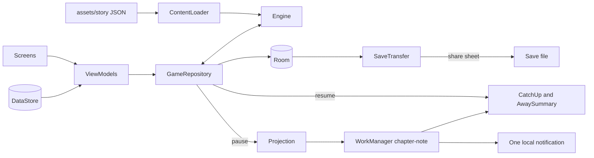

# Inkhorn: a medieval book trade that ends

One candle, one quill, one line of ink: "The abbot wants a psalter by Lent." Inkhorn is an idle incremental game told as a written ledger. A copying desk grows into an ink mill, a bindery, a lending library, a press and a printing city; eleven choices cannot be taken back; they lead to one of three endings; the credits roll. It sells a branching story with a last page and nothing to buy after the price.

## 1. Overview

- **Elevator pitch:** a slow-reveal idle game about the medieval book trade: one button at launch, six chapters, eleven permanent choices, three endings, New Game+.
- **Play category:** Games, Simulation.
- **Tagline:** A medieval book trade that ends.
- **Positioning line:** "Slow-reveal storytelling in a book trade you grow from one quill to a printing city, with choices that change the ending, and no ads ever."
- **Price:** USD 2.99, INR 149, one-time.
- **Name:** Scriptorium collides with *Scriptorium: Master of Manuscripts* (Yaza Games, 2026). An inkhorn is a scribe's horn ink pot; no titled Play match.

## 2. Problem and why now

The buyer likes incremental games but is tired of free ones: endless prestige resets, an ad or gem pack behind every speed-up. They want a system that unfolds, and an end. They type "idle game offline" or "incremental game no ads", built from modifiers Google web autocomplete returns ("games without ads", "games no in app purchases", "idle game"), a proxy for Play search language rather than Play data (https://suggestqueries.google.com/complete/search?client=firefox&hl=en&gl=us&q=games%20without%20ads).

**Demand is measured.** Kittens Game ($2.99, 50K+, 4.51) went from 3,195 ratings in April 2025 to 3,347 in September 2026 and Universal Paperclips ($1.99, 50K+, https://play.google.com/store/apps/details?id=com.everybodyhouse.paperclipsuniquetest) from 1,823 to 2,016, about 10 to 16 a month each for old web ports (https://www.androidrank.org/application/x/com.nuclearunicorn.kittensgame). The narrative leaders are bigger: A Dark Room ($1.99, 100K+, 4.66 from 10,028 ratings, https://play.google.com/store/apps/details?id=com.yourcompany.adarkroom) and SPACEPLAN ($2.99, 100K+, 4.46 from 7,617, https://play.google.com/store/apps/details?id=com.devolver.spaceplan). A Dark Room is the first paid result for "text adventure incremental" on Play US (https://play.google.com/store/search?q=text%20adventure%20incremental&c=apps&price=2): the buyer for a narrative that ends already exists.

**The honest ceiling.** The paid filter for "incremental game" on Play US shows 20+ titles (https://play.google.com/store/search?q=incremental%20game&c=apps&price=2), and no-brand originals sit low: Tiny Biomes ($2.49, 100+ installs, https://play.google.com/store/apps/details?id=com.orcapoints.tinybiomes), System Ascension (500+, https://play.google.com/store/apps/details?id=com.studiorouleau.systemascension), PegIdle (1K+, https://play.google.com/store/apps/details?id=com.eagleeyegames.pegidle). Inkhorn plans for hundreds of early installs, not thousands, and is scoped to five weeks.

**The free incumbent, answered.** *Idle Magic Clicker: Fair Game* is free, ad-free, IAP-free and offline, with 500K+ installs and 4.69 from 18,544 ratings (https://play.google.com/store/apps/details?id=idle.magic.tycoon.tap.game); *Cell: Idle Factory* (500K+, https://play.google.com/store/apps/details?id=com.OctocubeGamesCompany.CIFI) is close behind. Fair Game removes the reason people hate free idle games, so "no ads" cannot carry $2.99 alone. Both free incumbents sell fairness and systems depth, not a written story with a last page; the incrementals that do sell that on Play, A Dark Room and SPACEPLAN, are paid and hold 100K+ each (listings cited above). That is the thing buyers already pay for, so v1.0 sells it: a written story, eleven consequential decisions, three endings, credits and a second chronicle.

**Why now.** March 2026 brought Game Trials for paid games (https://android-developers.googleblog.com/2026/03/building-a-bigger-stage.html); Play Pass pays by time engaged (https://play.google.com/console/about/programs/googleplaypass/).

## 3. Target audience and personas

- **Megan Hollis, 34, night-shift ward nurse, Leeds.** Deleted two idle games this year over ad walls. Types "idle game no ads". Pays when screenshot two shows a choice written as prose: a book, not a slot machine.
- **Arjun Nair, 27, QA engineer, Pune.** Finished Paperclips twice and A Dark Room once. Types "incremental game offline" on a commute with patchy data. He pays at "eleven choices you cannot take back", because neither game he finished asked him to choose along the way.
- **Dana Whitcomb, 46, school librarian, Columbus, Ohio.** Drawn to anything about books. Types "story game with choices no ads". Pays because 6 to 10 hours and an ending fit a week of evenings.

## 4. Core concept deep-dive

**How it works.** A deterministic tick engine runs the workshop. Resources (vellum, ink, folios, books, pennies, renown; later paper and type) come from taps and hired workers; upgrades multiply rates or unlock actions. Each chapter has one goal ("Bind the abbot's psalter") and one or two choices.

**The first minute.** One line of prose, one button: "Copy a line". Five taps in, "Sell the page" appears; "Buy vellum" and "Hire a novice" follow. No tutorial.

**Choices.** A short passage with two or three options; each changes production and adds a point to Commons, Crown or Cloister. The final choice counts double; a tie goes to the tied leaning favoured by the most recent choice that favoured any of them. The highest leaning picks *The Open Stacks*, *The King's Printer* or *The Quiet Cloister*. No reloads. Every choice spans at least two leanings, so all three endings stay reachable into chapter six.

**The eleven choices.** 1 The Quill: the forbidden herbal; the abbot's tithe. 2 The Ink Mill: the river rights; the oak-gall harvest. 3 The Bindery: the chained books; the guild seal. 4 The Lending Library: who may borrow; the heretic's commentary. 5 The Press: the scribes' strike; the royal patent. 6 The Printing City: the last edition (counts double).

**Time.** One game day is ten minutes of game time; the ledger dates rows by game day.

**The one memorable thing: the growing initial.** Chapter progress is never a bar. It is the chapter's first letter, set large, with a verdigris vine that draws itself around the letter in proportion to progress toward the goal. The path is trimmed to the progress fraction each frame, so it is state, not animation, and reads correctly with animations off.

**Away time.** On resume the engine replays elapsed time in coarse steps, capped per chapter (two hours in chapter one, four in chapter two, eight from chapter three), stopping at a goal or an unanswered choice. The ledger writes one entry from the replay: "While you were away, three days' copying: 412 folios, 18 books bound."

**What it refuses to do.** No prestige loop, endless mode, premium currency, energy, daily rewards, streaks, widget, account or leaderboard.

## 5. Complete feature set

**v1.0:**
1. Six chapters: The Quill, The Ink Mill, The Bindery, The Lending Library, The Press, The Printing City.
2. Forty-eight named upgrades and fourteen worker types.
3. Eleven permanent choices with production trade-offs.
4. Three endings with their own passages and credits.
5. A 6 to 10 hour arc enforced by a balance simulation test.
6. Slow-reveal opening: one line, one button.
7. Offline progress with a written, capped "while you were away" entry.
8. New Game+: chapter one and two goals and costs at 60 percent, margin notes on last run's choices.
9. Chronicle: every choice in every run, endings found, time played.
10. The growing initial on every chapter.
11. Light, dark and true-black themes.
12. One optional notification when a chapter finishes while away.
13. Save transfer: send through the share sheet, load back.
14. Share chronicle as plain text.

**Cut, per the refutation:** the Glance widget; replay from any chapter (New Game+ replaces it); two-pane tablet layout and keyboard shortcuts; the 12 to 15 hour arc. The refuter also cut SAF save export and import, but the batch contract requires export and re-import, so 1.0 keeps two Settings rows (share-sheet send, one `OpenDocument` load) and no backup screen.

**v1.x:** an optional bundled ambient sound bed; a Hindi ledger in the same app. **v2:** an "author's margin" view explaining how each choice moved the numbers. Nothing was cut for offline honesty; nothing online was planned.

## 6. Screen-by-screen UX

**Navigation.** One activity, one `NavHost`. Destinations appear as the story reaches them (Ledger at launch, Workshop at the first affordable upgrade, Chronicle after the first choice) in a bottom `NavigationBar`, hidden until a second destination exists. Settings sits behind a gear. Choices, away entry and notification ask are sheets; the ending is a full-screen route.

**Ledger (home).** Chapter number in words and title; the growing initial beside the chapter's opening sentence; stores as spaced rows ("412 folios, 3 a minute" in tabular figures); full-width action buttons whose cooldown is an ink line along the bottom edge (reduced motion: seconds as text); the ledger, newest first, dated "Day 12".

**Workshop.** Hands (worker, count, cost, output, "Hire") and Improvements (name, period line, cost, effect, "Buy"). Unaffordable items say "Needs 40 more pennies".

**Choice sheet.** Passage (up to 120 words), two or three bordered options with one consequence sentence each. Tap selects; "Commit to this" confirms, under a Rubric line: "You cannot change this later."

**Away entry.** Sheet on resume after more than five minutes: the entry, the three largest changes, "Back to work".

**Notification ask.** A sheet once, when chapter one ends: "Inkhorn can tell you when a chapter finishes while the game is closed." "Tell me" turns Chapter notes on and shows the system prompt on Android 13+; "Not now" leaves the Settings toggle off. Both set `notes_asked`.

**Chronicle.** Current run (choices with day, leaning in words), past runs with ending names, three ending slots ("An ending not yet found"), "Share chronicle".

**Ending.** The ending passage, credits (writer, fonts and licences), "Begin a second chronicle" and "Return to the ledger".

**Settings.** Theme, Chapter notes, Haptics, Send save file, Load save file, Privacy policy (bundled HTML), Licences.

**Flow 1, first minute:** launch; first line inks in; five taps on "Copy a line"; "Sell the page" appears; "Buy vellum" at four pennies; "Hire a novice" at ten; the Workshop tab appears.

**Flow 2, a choice:** production pauses; ledger: "Brother Osric brings a herbal the bishop has forbidden."; the sheet opens; Arjun selects "Copy it by candlelight", taps "Commit to this"; Chronicle gains a row; rates change; production resumes.

**Flow 3, away:** Megan leaves with notes on; the projection lands inside the cap, so one job is queued; hours later: "The bindery is finished. Chapter four waits in the ledger."; she taps, the gap replays, the away sheet shows.

## 7. Design system

**Design read:** Reading this as: a narrative idle game for adult readers who want an ending, with a working-manuscript language, leaning toward Grenze Gotisch plus Alegreya on a verdigris and iron-gall palette.

**Palette family: verdigris and iron-gall.** Verdigris is the copper green of painted borders; iron-gall the blue-black ink scribes wrote in. The ground is cool sage-grey, not cream; no gold, brass or terracotta.

**Dials.** Variance 4: reading needs a steady column; the initial is the only asymmetry. Motion 3: idle numbers already move, so motion only answers taps. Density 5: stores, actions and ledger share a screen, split by spacing, not cards.

| Token | Role | Light | Dark | True black |
|---|---|---|---|---|
| Vellum | background | #E9EEE8 | #131A1B | #050707 |
| Leaf | sheets, option blocks, nav bar | #F5F7F2 | #1B2426 | #101617 |
| IronGall | text, icons | #1C2233 | #E2E8E1 | #E2E8E1 |
| FadedInk | secondary text | #4F5A6E | #9AA8A3 | #9AA8A3 |
| Verdigris | the one accent: buttons, vine, selected nav | #1F7466 | #62B8A8 | #62B8A8 |
| Rubric | irreversible warning and errors only | #A33A2C | #E48A78 | #E48A78 |

Verdigris is 58 percent saturation in light, 38 in dark, locked on every screen. Contrast on Vellum, light then dark: IronGall 13.5 and 14.2:1, FadedInk 5.9 and 7.1:1, Verdigris 4.8 and 7.5:1, Rubric 5.6 and 6.9:1; button labels Leaf on light 5.2:1, Vellum on dark 7.5:1. Dividers are IronGall at 12 percent alpha. True black swaps Vellum and Leaf at runtime.

**Type.** Display: **Grenze Gotisch** SemiBold 600 (Google Fonts, Omnibus-Type), for the initial and chapter and ending titles only; screen, sheet and dialog titles are Alegreya Medium. Text: **Alegreya** Regular 400, Italic 400, Medium 500, Bold 700 (Google Fonts, Huerta Tipografica), with `fontFeatureSettings = "lnum, tnum"` on counts. Both SIL Open Font License 1.1; `OFL.txt` copied to `docs/OFL-GrenzeGotisch.txt` and `docs/OFL-Alegreya.txt`. The serif is earned: the subject is a manuscript and Alegreya was drawn for long literary text. Scale: initial 72sp, title 28sp, heading 20sp Medium, body 16sp at 1.5 line height and a 60-character measure, labels 14sp Medium.

**Radius.** RadiusSm 4dp (buttons, options), RadiusMd 8dp (away entry, snackbars), RadiusLg 16dp (sheet top corners).

**Icons.** Material Icons Rounded (`material-icons-extended`) for chrome only: settings, back, close, share.

**Motion.** One first-run moment: the first ledger line reveals left to right over 900 ms, once per install. Otherwise new rows fade in 200 ms, unchosen options fade 250 ms on commit, taps give a light haptic. No loops or shimmer. Everything reads `LocalReducedMotion` and snaps; credits become a static page.

**States.** Ledger: empty is the designed one line and one button; loading is a skeleton of initial, store rows and buttons; error "This save could not be read. Your last good save is loaded." (from `previousStateJson`; if that also fails, "This save could not be read. Load a save file from Settings or begin a new chronicle." with both buttons); success is the ledger line naming the action ("Copied a line"). Workshop: empty "Nothing to buy yet. Sell pages to earn pennies." with "Back to the ledger"; loading and error as Ledger; success "Hired a scrivener". Choice sheet: never empty or loading; Commit disabled until selection; error keeps it open: "The choice was not written. Commit again."; success is the ledger line. Away entry: never empty or loading (skipped under five minutes, computed before opening); a catch-up failure shows the Ledger error instead; success is "Back to work". Chronicle: empty "Your first choice will be written here."; skeleton rows; error "The chronicle could not be read."; success "Chronicle shared". Ending: never empty; skeleton passage; error "This ending could not be opened." with "Return to the ledger"; success "Began a second chronicle". Settings: never empty, no loading (DataStore rows); success "Save file sent" and "Save file loaded" after "Loading replaces your current run."; errors "That file is not an Inkhorn save." and "That save is from a newer version of Inkhorn."

**Access.** 48dp targets, icon `contentDescription`s, one TalkBack node per store row, unclipped font scaling, WCAG AA in all themes.

**Large screens.** A centred column capped at 600dp; state survives rotation through ViewModel and `rememberSaveable`.

**Screenshots (9:16, seeded mid-run).** 1 Ledger light, The Bindery, vine two-thirds drawn. 2 Choice sheet, "The chained books". 3 Workshop in chapter four. 4 Away entry. 5 Chronicle in dark, one ending found. 6 Ledger in true black, The Press.

**Icon.** Ground a verdigris gradient from #2CC4A8 (dominant stop, 63 percent saturation, 47 percent lightness) to #1AA29A (72 percent, 37 percent); mark an ink horn with a quill in it, both IronGall (7.2:1 and 5.0:1 on the two stops, so the thin quill passes the 3:1 rule). A near-white mark fails 3:1 on any ground in ICON.md's lightness band, so the mark is dark ink, the feather lit by a Leaf highlight edge. Registry hue family: teal, the accent's family.

## 8. Native architecture

```
new-native-app.sh --name "Inkhorn" --pkg com.mohdshayan.inkhorn --perms "POST_NOTIFICATIONS" --room --work --bg "#E9EEE8" --bg-dark "#131A1B" --orient unspecified
```

**Modules.** `:app` only. The engine is plain Kotlin with no Android imports, tested in `app/src/test`.

**Package map** (`com.mohdshayan.inkhorn`): `engine/` (GameState, Content, Engine, CatchUp, Projection, EndingResolver, AwaySummary, NumberWords, SaveCodec); `content/ContentLoader`; `data/db/`; `data/prefs/AppPrefs`; `data/GameRepository` (owns `StateFlow<GameState>`, ticks 10 per second in the foreground, autosaves every 30 seconds and on `onStop`, catches up on `onStart`); `data/SaveTransfer`; `work/`; `ui/ledger/` (with GrowingInitial, ChoiceSheet, AwaySheet), `ui/workshop/`, `ui/chronicle/`, `ui/ending/`, `ui/settings/`. ViewModels are `AndroidViewModel`s using `stateIn(WhileSubscribed(5_000))`.

**Catalog aliases:** `androidx-core-ktx` (includes `FileProvider`), `androidx-core-splashscreen`, `androidx-lifecycle-runtime-ktx`, `androidx-lifecycle-runtime-compose`, `androidx-lifecycle-viewmodel-compose`, `androidx-activity-compose`, `androidx-compose-bom`, `androidx-ui`, `androidx-ui-graphics`, `androidx-ui-tooling`, `androidx-ui-tooling-preview`, `androidx-material3`, `androidx-material-icons-extended`, `androidx-navigation-compose`, `androidx-room-runtime`, `androidx-room-ktx`, `androidx-room-compiler`, `androidx-datastore-preferences`, `androidx-work-runtime-ktx`, `kotlinx-coroutines-android`, `kotlinx-coroutines-test`, `kotlinx-serialization-json`, `junit`; plugins `android-application`, `kotlin-android`, `kotlin-compose`, `kotlin-serialization`, `ksp`. Added: `google-play-review-ktx` (`com.google.android.play:review-ktx:2.0.2`, resolves on Google Maven; its merged manifests add no permissions).

**Hardware:** none; Compose haptics need no permission. **Bundled assets.** Story JSON, about 9,000 words of original writing in v1.0 (the plan was roughly 15,000; the shortfall is recorded in DESIGN-NOTES.md), under 1 MB. Grenze Gotisch and four Alegreya TTFs, about 1.5 MB, OFL 1.1. Privacy policy HTML. No audio, no raster art.

**Permissions.**
- `POST_NOTIFICATIONS`: one optional note when a chapter finishes while the game is closed; asked in context, the game plays the same if denied.
- Merged by WorkManager: `WAKE_LOCK` (holds the CPU while the note job runs), `RECEIVE_BOOT_COMPLETED` (keeps a pending note across reboot), `FOREGROUND_SERVICE` (library support; Inkhorn starts none), `ACCESS_NETWORK_STATE` (constraint tracking; Inkhorn sets no network constraint).
- `INTERNET` is absent. The `FileProvider` (authority `${applicationId}.files`, so the `.debug` build does not clash; cache path `exports/`) adds none.

**Background work.** One unique `OneTimeWorkRequest` named `chapter-note`, enqueued with `REPLACE` on pause when notes are on and `Projection` puts the goal inside the away cap, delayed by the projected seconds. The worker runs `CatchUp` on the snapshot and posts only if the goal is really met; resume cancels it. No periodic work, exact alarms, widgets or tiles.



## 9. Data model

**Room entities** (version 1):
- `RunEntity`: `id: Long` PK autogenerate, `startedAt: Long`, `endedAt: Long?`, `endingId: String?`, `chronicleNumber: Int`, `playSeconds: Long`.
- `SnapshotEntity`: `runId: Long` PK, `engineVersion: Int`, `stateJson: String`, `previousStateJson: String?` (the prior autosave, loaded if `stateJson` fails to decode), `savedAt: Long`; saved in one transaction with pending ledger rows.
- `LedgerEntryEntity`: `id: Long` PK, `runId: Long` indexed, `gameDay: Int`, `chapter: Int`, `kind: String` (story, away, choice, chapter_end), `text: String`, `createdAt: Long`.
- `ChoiceRecordEntity`: `runId: Long` plus `choiceId: String` composite PK, `optionId: String`, `chapter: Int`, `gameDay: Int`, `madeAt: Long`.

**GameState** (snapshot JSON): `chapter: Int`, `gameSeconds: Double`, `resources: Map<String, Double>`, `workers: Map<String, Int>`, `upgrades: Set<String>`, `revealed: Set<String>`, `cooldowns: Map<String, Double>`, `pendingChoiceId: String?`, `leanings: Map<String, Int>`, `newGamePlus: Boolean` (second chronicle onward), `lastWallClockMs: Long`.

**DataStore keys:** `theme` (system, light, dark, true_black), `chapter_notes` (false), `notes_asked`, `haptics` (true), `first_line_played`, `chapters_completed_total`, `review_prompted`, `onboarding_done`.

**Export and import.** `inkhorn-save-day<N>.json`, `application/json`: `{ "format": "inkhorn-save", "formatVersion": 1, "engineVersion": 1, "exportedAt": <ms>, "runs": [...], "snapshot": {"runId", "state"}, "ledger": [...], "choices": [...] }`, each array holding the entity fields above. Export is `ACTION_SEND` with a `FileProvider` URI. Import reads an `OpenDocument` URI, checks `format`, rejects a newer `engineVersion`, confirms, and replaces all four tables in one transaction. Backup rules include the database and DataStore so Android device transfer carries the save.

## 10. Pricing and countries

**USD 2.99 and INR 149**, on the batch ladder's "Premium game original" rung. Mobile-native paid originals sell at $0.99 to $3.99, and INR 149 to 199 is the safe Indian band. INR is hand-set, never FX-converted; BRL, IDR, TRY and NGN are hand-set at 25 to 50 percent of the US price; every other paid-app country takes the converted price.

**Launch pricing:** none at launch; one 20 percent sale for seven days after the first 30 days at full price (Play sales: 1 to 14 days, at least 10 percent off, 30 days apart); never a $0 sale.

**Refunds:** Google handles requests in the first 48 hours; after that, any request within 14 days is refunded through Play Console without questions.

**Why this much.** SPACEPLAN charges $2.99 for one linear run; Inkhorn gives a longer arc with branches. $1.99 signals a smaller game; more, without a fanbase, sits beside titles with Steam communities.

## 11. Play Store listing

**Title:** `Inkhorn: Idle Incremental Game` (30 characters)

**Short description:** `Grow a medieval scriptorium to a printing city. Story that ends. No ads or IAP.` (79 characters).

**Full description** (1,701 characters):

```
Inkhorn is an idle incremental game with a written story that ends. Start with one quill; finish as master of a printing city.
The ending depends on eleven choices you cannot take back.
No ads. No in-app purchases. No energy timers. The price buys the whole game.

One-time purchase. No ads, no subscription, no account. Works fully offline.

A story first
Six chapters of the medieval book trade, from the quill to the printing press. New mechanics arrive through the story, not a tutorial.

Choices that stay made
Copy the forbidden herbal or refuse it. Chain the books to the desks or let them leave the house. Break the scribes' strike or teach them to set type. Each choice changes what your workshop produces and leans the town toward one of three endings.

An idle game that ends
The story is tuned for about 6 to 10 hours of play. No infinite prestige loop, no grind wall. When the credits roll, the game is finished.

While you were away
Your scribes keep copying while you are away, and the ledger writes what happened. A long break never skips a chapter or makes a choice for you.

A second chronicle
Finish once and begin again with a faster start, margin notes on what you chose last time, and a record of the endings you have found.

Made to be read
Illuminated chapter initials that fill in as you progress, book typography, and light, dark and true black themes.

One optional note
Inkhorn can send one notification when a chapter finishes while you are away. It asks once and plays the same if you say no.

Your save is yours
Send your save file through the share sheet and load it on another phone.

No ads, no in-app purchases, no account, no internet permission, no data collected.
```

**Keywords:** idle game offline, incremental game, idle game no ads, games without in app purchases, story game with choices, multiple endings, text adventure, medieval, printing press.

**Screenshot captions:** 1 "A story that ends. Six chapters, three endings." 2 "Eleven choices you cannot take back." 3 "No ads. No in-app purchases. Works offline." 4 "While you were away, the ledger kept writing." 5 "Every choice and ending, kept in your chronicle." 6 "Light, dark and true black."

**Feature graphic:** verdigris gradient ground, the ink horn mark large at left, "Inkhorn" in Grenze Gotisch, one Alegreya line: "A medieval book trade idle game that ends". No price or badges.

**Category** Games, Simulation. **Content rating** Everyone expected (no violence shown, no gambling, no user interaction, no purchases). **Target age** 16 and over. Paid, no ads, no in-app purchases, works offline, stated plainly above.

## 12. Policy and data safety

**Data safety:** collected none, shared none, no account deletion needed. The save file leaves the device only when the player sends it; Auto Backup is the operating system's feature.

**Declarations:** `POST_NOTIFICATIONS` needs no form; no exact alarms; no health or financial declarations; ads "No"; app access unrestricted; target audience 16+ with nothing child-directed. Privacy policy generated from the manifest, hosted and bundled.

**Game Trials and Play Pass** are Console enrolments; the app adds no trial logic, licence check or network call.

**The listing must not claim:** historical accuracy; any competitor name or link; a Play Pass badge before acceptance; "free"; play length outside 6 to 10 hours; unshipped translations.

## 13. Organic growth

**Search.** The title carries "idle" and "incremental game". The short description adds "medieval", "scriptorium", "ends", "no ads" and "IAP", the buyer modifiers. The full description's first lines repeat "idle incremental game", "story" and "no in-app purchases" for Ask Play.

**Review prompt.** `requestReviewFlow()` once, on returning to the ledger after chapter three (the third success), never on first launch or over a sheet.

**Launch.** A 30-second recording posted to r/incremental_games; Play Pass application; Game Trials; the day-31 sale; replies to early reviews.

**Not done:** paid acquisition, incentivised reviews, a Lite twin, competitor trademarks.

## 14. KPIs

Inkhorn sends nothing. Chronicle shows players their own local counts (chapters, choices, endings, time played), never transmitted. The developer reads three numbers in Play Console:

1. **Refund rate** under 10 percent of orders in the first 30 days; higher means chapter one misses the 48-hour window.
2. **Store listing conversion** for "idle game no ads" and "incremental game", compared after each listing change.
3. **Rating at or above 4.5** with reviews naming the story or ending; reviews naming grind trigger a balance patch for that chapter.

## 15. Risks and mitigations

- **Refund window.** Mitigation: a mechanic inside a minute, chapter one inside a first session (tested), a choice in screenshot two.
- **Biggest free incumbent,** *Idle Magic Clicker: Fair Game*. Mitigation: never compete on "fair"; every listing surface leads with the story, the choices and the ending.
- **Hardest subsystem: deterministic catch-up and balance.** Mitigation: one engine and fixed step for foreground, catch-up and projection; a coarse-versus-fine test within 1 percent; a backwards clock counts as zero.
- **Writing quality.** About 9,000 words carry v1.0 (planned 15,000): a story line every five to ten minutes of play. Mitigation: chapter one written and play-tested in week one; a content test for passage length and dashes.
- **Crowded niche, no fanbase.** Mitigation: five-week cost, Play Pass, precise listing modifiers.
- **Grind reviews.** Mitigation: the greedy-bot balance test caps chapter length.
- **Name confusion.** Mitigation: the name is Inkhorn; "scriptorium" is only a common noun.

## 16. Competitive landscape

| App | Price | Installs | Rating | Updated | Why Inkhorn instead |
|---|---|---|---|---|---|
| A Dark Room | $1.99 | 100K+ | 4.66 (10,028) | Mar 2026 | Eleven choices steer three endings. |
| SPACEPLAN | $2.99 | 100K+ | 4.46 (7,617) | Dec 2025 | Longer, branching. |
| Scritchy Scratchy | $6.99 | 100K+ | 4.72 (6,011) | Sep 2026 | Under half the price, a story. |
| Magic Research | $3.99 | 100K+ | 4.68 (2,059) | Oct 2025 | Cheaper, story-led. |
| Magic Research 2 | $4.49 | 50K+ | 4.76 (968) | Aug 2024 | Cheaper, with three endings. |
| Kittens Game | $2.99 | 50K+ | 4.51 (3,347) | Jul 2026 | Phone-native, ends. |
| Universal Paperclips | $1.99 | 50K+ | 4.31 (2,016) | Feb 2026 | Choices all the way through. |
| Keep on Mining! | $3.99 | 10K+ | 4.34 (344) | Oct 2025 | Story, not mining. |
| PegIdle | $3.99 | 1K+ | 4.16 (16) | Oct 2025 | Cheaper, narrative. |
| Rule1A Incremental | $4.99 | 1K+ | 2.55 (40) | Apr 2026 | Cheaper, tested arc. |
| System Ascension | $4.99 | 500+ | 3.66 (23) | Aug 2026 | Cheaper, tested arc. |
| Tiny Biomes | $2.49 | 100+ | 4.71 (17) | May 2026 | Endings, not sandbox. |
| Idle Magic Clicker: Fair Game | free, no ads or IAP | 500K+ | 4.69 (18,544) | Oct 2025 | Authored story, ending. |
| Cell: Idle Factory | free | 500K+ | not recorded | Sep 2026 | A finish line. |
| Idle Slayer | free, ads, IAP | 5M+ | 4.59 (133,153) | Aug 2026 | No ads or gems. |
| Idle Iktah | free, optional IAP | 100K+ | 4.60 (6,661) | Aug 2026 | Nothing more to buy. |

## 17. Development plan

- **Week 1:** generate, `make-key.sh inkhorn`; `engine/` (tick, CatchUp, Projection, EndingResolver, SaveCodec) with tests; chapter one written and play-tested on a debug screen.
- **Week 2:** theme, fonts; Ledger, growing initial, Workshop; Room, autosave, catch-up, away sheet; states; chapter two.
- **Week 3:** chapters three and four with choices; choice sheet; Chronicle; Settings with save transfer; balance passing through chapter four.
- **Week 4:** chapters five and six, three endings, credits, New Game+, share chronicle; balance passing through the whole arc.
- **Week 5:** chapter-note worker and permission ask, review prompt, TalkBack and large-font pass, icon per `ICON.md`, screenshots, listing, privacy policy, README, preflight.

**Total: 5 weeks.**

**If behind, cut in order:** share chronicle, review prompt, chapter-note notification (with `POST_NOTIFICATIONS` and `--work`), New Game+ margin notes. Never cut choices, endings, the away entry, true black, the initial or save transfer.

**JVM tests:** `EngineTickTest` (cooldowns, production, costs, multipliers); `CatchUpTest` (stops at goal and pending choice, cap honoured, backwards clock, coarse equals fine within 1 percent); `ProjectionTest` (matches catch-up); `EndingResolverTest` (all three reachable, final choice doubles, ties resolved by recency); `BalanceSimTest` (a greedy bot acting every 10 simulated seconds, no away time, finishes chapter one within 30 minutes and the arc in 6 to 10 hours, no chapter over twice its neighbour); `ContentIntegrityTest` (six chapters, 48 upgrades, 11 choices, ids resolve, passage limits, no U+2014 or U+2013); `SaveCodecTest` (round trip, wrong format and newer version rejected); `NumberWordsTest`.

**Emulator smoke:** fresh install shows one button; make a choice, see it in Chronicle; kill and relaunch; clock three hours ahead gives a capped away entry; rotate in a choice sheet; dark and true black; deny notifications; send the save, clear app data, load it back; airplane mode throughout.

**Preflight:** `build.sh inkhorn` prints `CN=SocialSure Private Limited`, tests green; `verify.sh inkhorn` no FAIL; `smoke.sh inkhorn com.mohdshayan.inkhorn` passes; merged manifest matches section 8; OFL files in `docs/`; policy hosted; Paid set before first release; testing tracks paused after release.
